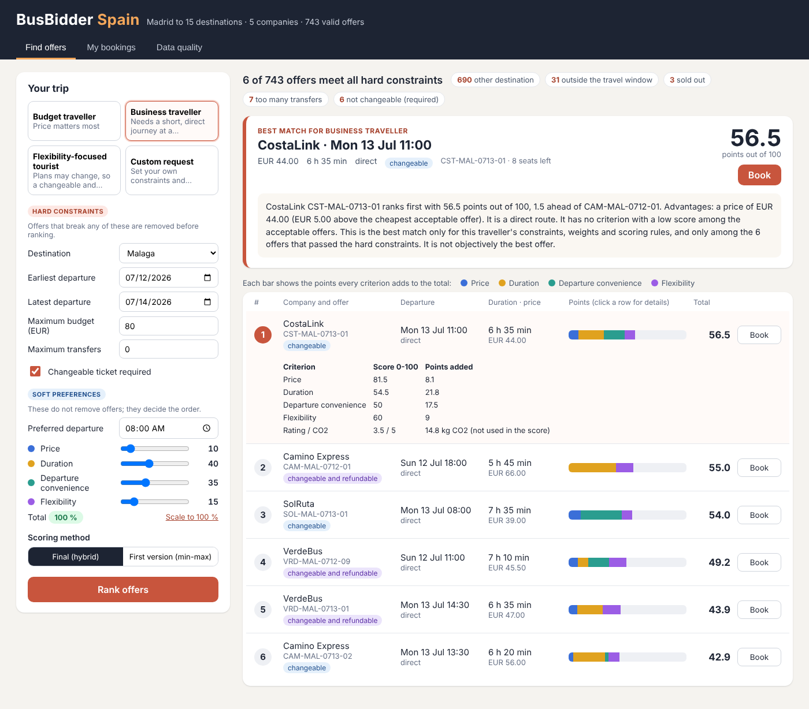
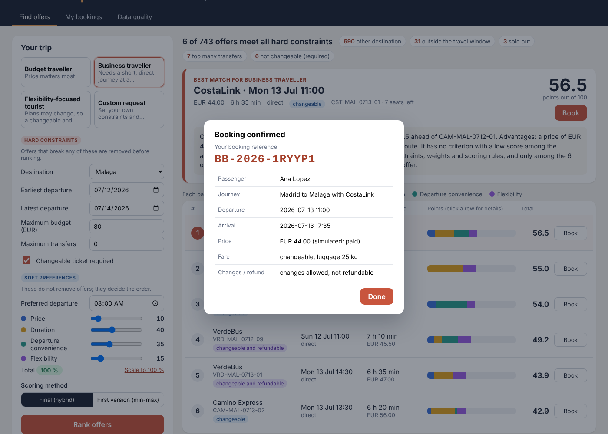

# BusBidder Spain

ACIT4420 Problem-solving with scripting – final project
**Student:** Roshni Neupane

A command-line application that filters and ranks competing bus offers from Madrid
according to the requirements and preferences of an individual traveller, explains the
recommendation, and makes simulated bookings.

## Requirements

- Python 3.10 or newer (developed and tested with Python 3.13)
- No third-party libraries: only the Python standard library is used
  (`argparse`, `csv`, `json`, `logging`, `re`, `random`, `datetime`, `pathlib`, `unittest`)

## Running the program

Run every command from the project folder (the folder that contains `main.py`).
On Windows use `python`; on macOS/Linux use `python3`.

| Purpose | Command |
|---|---|
| **Web interface** in the browser (opens http://127.0.0.1:8000) | `python main.py web` |
| Interactive menu in the terminal (rank, compare, own request, book, cancel) | `python main.py` |
| Ranking for one profile | `python main.py rank --profile budget` |
| The three profiles side by side | `python main.py compare` |
| Book rank 1 for a profile without the menu | `python main.py book --profile budget --rank 1 --name "Ana Lopez"` |
| Produce the experiment results used in the report | `python main.py experiments` |
| Use the first scoring version (min-max for every criterion) | `python main.py --method minmax rank --profile business` |
| Run the automated tests | `python -m unittest` |
| Recreate the simulated offers (same result every time) | `python scripts/generate_offers.py` |

Profile keys: `budget`, `business`, `flexible`.

The web interface uses Python's built-in web server and only listens on this computer
(127.0.0.1). Stop it with Ctrl+C in the terminal. Use `--port 8080` if port 8000 is busy.

Optional settings for every command: `--data`, `--profiles`, `--bookings`, `--output`, `--log`
(defaults: `data`, `data/profiles.json`, `storage/bookings.json`, `output`, `logs/busbidder.log`).

## Project structure

```
main.py                     entry point
busbidder/
  models.py                 Company, Destination, FareConditions, Offer, TravelRequest, TravellerProfile
  validation.py             regular expressions, type conversion, range and consistency checks
  loader.py                 reads the data files, builds the Marketplace, sets invalid rows aside
  constraints.py            hard constraints (registered with the @hard_constraint decorator)
  scoring.py                criteria (registered with the @criterion decorator), normalisation, ranking
  explain.py                data-based explanation of the rank-1 offer
  display.py                text tables for the console
  booking.py                Booking and BookingManager (references, seats, cancellation)
  experiments.py            experiments E1–E6 for the report
  cli.py                    interactive menu and commands
  web.py                    local web server and JSON API for the web interface
  static/index.html         the web page (HTML, CSS and JavaScript, no external files)
  logging_setup.py          log file configuration
  exceptions.py             custom exceptions
data/
  companies.csv             5 fictional companies
  destinations.csv          15 destinations served from Madrid
  offers.csv                743 simulated offers, 10–16 July 2026 (made by scripts/generate_offers.py)
  offers_invalid.csv        15 deliberately invalid or unusual rows for testing validation
  profiles.json             three traveller profiles (requests and weights)
scripts/generate_offers.py  seeded data generator
tests/                      51 automated tests
docs/architecture.png       architecture diagram
docs/screenshots/           screenshots of the web interface
```

Files created by the program: `output/review_queue.csv` (rows set aside),
`output/experiments.md` and `output/rankings/*.csv` (experiment results),
`storage/bookings.json` (bookings) and `logs/busbidder.log` (log).

## How it works

1. **Load and validate.** Every value is converted to its type and checked: missing values,
   impossible values (negative price, rating outside 1–5, negative seats), unknown companies or
   destinations, invalid dates, arrival not after departure, and inconsistent values (a refundable
   fare that is not changeable, an offer ID that does not match its company or destination).
   Lower-case codes are *corrected* and logged; all other invalid rows are *set aside for review*
   in `output/review_queue.csv`. Sold-out offers are valid data and are removed by the seat constraint.
2. **Filter.** Hard constraints remove unacceptable offers: destination, travel window, free seats,
   budget, maximum transfers and, if required, a changeable ticket. The user sees how many offers
   each constraint removed.
3. **Rank.** Four criteria are scored 0–100: price and duration with min-max normalisation among
   the acceptable offers; departure convenience on a fixed scale (100 at the preferred time, 0 at
   6 hours away); flexibility on fixed points (fixed 0, changeable 60, changeable and refundable 100).
   The total is the weighted sum. Weights must total 100 %. Ties are broken by lower price, then
   earlier departure. The min-max formula is written out in `scoring.py` instead of using a
   library such as scikit-learn's `MinMaxScaler` (which computes the same values), so every step of
   the score can be explained and tested, and no package needs to be installed.
4. **Explain and book.** The rank-1 offer gets an explanation with its advantages and
   disadvantages. A booking checks the seats, creates a reference such as `BB-2026-7K3QX9`, saves the
   fare conditions and reduces the capacity. No payment details are collected.

## Screenshots

Ranking for the business traveller, with the explanation and the points each criterion adds:



Booking confirmation:



More screenshots: `docs/screenshots/` (budget ranking, bookings, data quality).
